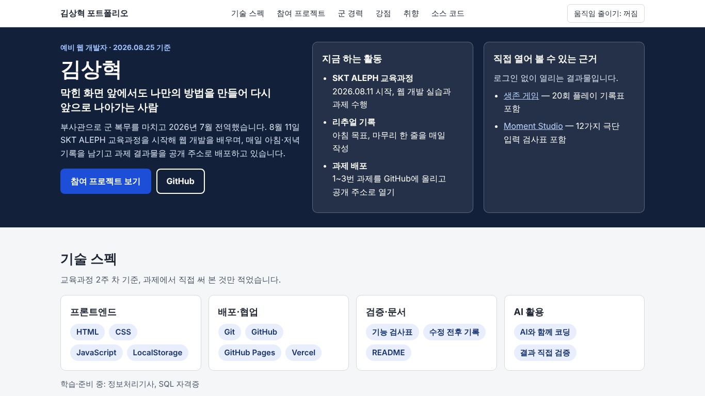
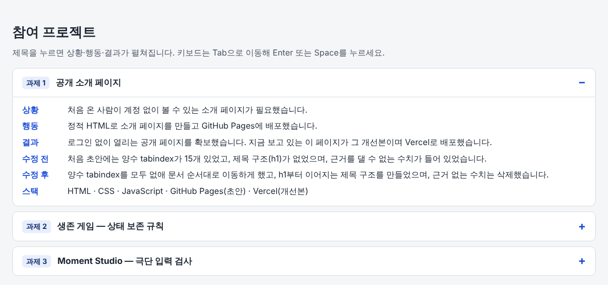
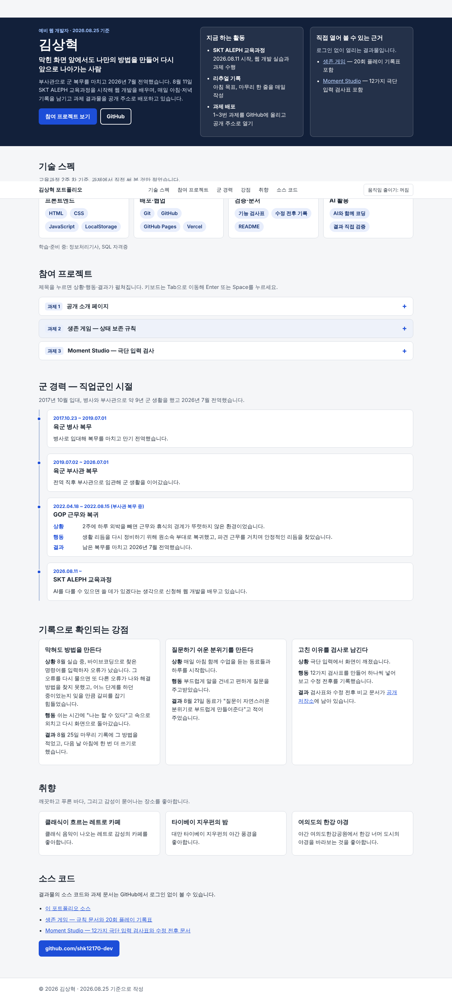

# 김상혁 | 예비 웹 개발자 포트폴리오

"나를 소개하는 한 페이지" 과제(T01)의 개선본입니다. 설치나 빌드 없이 `index.html`을 열면 동작하는 정적 페이지입니다.

- **공개 주소**: (Vercel 배포 후 기입)
- **소스**: https://github.com/shk12170-dev/portfolio_shk

## 웹페이지 구현 화면

**첫 화면 (1366×768)** — 이름, 한 줄 소개, 지금 하는 활동, 직접 열어 볼 근거가 스크롤 없이 보입니다.

**참여 프로젝트 — 과제 1 카드를 연 모습** — 상황·행동·결과와 수정 전/후를 확인할 수 있습니다.

**전체 화면 (1366px)** — 기술 스펙, 참여 프로젝트, 군 경력, 강점, 취향, 소스 코드 순서입니다.

**모바일 (375px)** — 1열 배치이며 가로로 넘치지 않습니다.

## 웹페이지 구현에 사용한 것

| 구분 | 사용한 것 |
|---|---|
| 화면 | HTML, CSS (프레임워크·외부 라이브러리 없음) |
| 동작 | JavaScript (프로젝트 카드 펼치기, 움직임 줄이기 버튼) |
| 접근성 | 본문 건너뛰기 링크, 제목 단계(h1 → h2 → h3), 키보드 조작(Tab·Enter·Space), 움직임 줄이기 |
| 저장소·배포 | Git, GitHub, Vercel |
| 검증 | 해상도 4종(1366·1920·768·375) 렌더링 측정, 문자열 검색 (`docs/CHECK.md`) |
| AI | Claude로 구성안·코드 작성과 점검을 했고, 사실 확인과 공개 범위는 직접 정했습니다 |

## 검증안내서

### 확인 방법 3단계

1. **주소를 엽니다.** 위 공개 주소를 로그인 없이, 새 시크릿 창에서 엽니다. 페이지가 바로 열리면 통과입니다.
2. **첫 화면을 봅니다.** 스크롤하지 않고 이름(김상혁), 지금 하는 활동, 직접 열어 볼 근거 링크 2개가 한 화면에 보이면 통과입니다.
3. **카드를 열고 링크를 누릅니다.** "참여 프로젝트"의 과제 1 제목을 눌러(키보드는 Tab → Enter) 수정 전/후가 펼쳐지는지 보고, 근거 링크(생존 게임, Moment Studio)가 새 탭에서 열리면 통과입니다.

### 안 될 때

- 화면이 움직이는 것이 불편하면 상단의 **움직임 줄이기** 버튼을 누릅니다.
- 근거 링크가 열리지 않으면 `docs/SCOPE.md`와 연락 섹션의 GitHub 저장소 링크로 같은 자료를 확인합니다.

## AI 3줄

* **AI에게 맡긴 일**: 소개 페이지 구성안과 HTML·CSS·JavaScript 작성, 해상도 4종 측정, 접근성 결함 점검(모바일 메뉴가 화면을 가리는 문제, 흰 배경에서 안 보이던 포커스 테두리) 및 수정
* **내가 판단한 일**: 실명 공개 여부, 취향·강점에 쓸 내용과 사실 확인, 군 경력 날짜와 GOP 문장의 공개 수위, 제출본을 지키기 위해 새 저장소에 올리는 방식
* **AI 말을 안 들은 일**: AI가 별명 사용과 동료 인용의 동의 확인을 짚었지만, 실명을 그대로 쓰기로 했고 동료 인용은 동의가 필요 없다고 판단해 그대로 둔 일

## 문서

- [`docs/SCOPE.md`](docs/SCOPE.md) — 공개할 것과 공개하지 않을 것
- [`docs/PLAN.md`](docs/PLAN.md) — 작업 방향
- [`docs/CHECK.md`](docs/CHECK.md) — 검사 기록
